# U1: right-docked UI direction

**Design review only. Final IDE approvals and the U1 verdict remain pending.**

Vim Keys occupies a native right-side tool window in both IDEs. The user opens it for learning and can hide or reposition it with the IDE's own controls. Updating the displayed hint must not reveal a hidden view or take over another tool window. The intended editing focus stays in the editor; this still requires behavior verification in Phase 3.

Open [the comparison gallery](gallery/index.html) locally, or review the 28 images below. This throwaway spike must not be merged. [U1 #15](https://github.com/92khsang/vim-companion/issues/15) records the design amendment; its full theme counts and separate approval requirements remain unchanged.

## Delivery status

| Area                | Current state                                                              | Next action                                                             |
| ------------------- | -------------------------------------------------------------------------- | ----------------------------------------------------------------------- |
| Docked layout       | Direction accepted for continued design; original 16 review cases retained | Preserve the layout and user-controlled visibility                      |
| Native Vim learning | Five reference topics and six simulated scenarios per IDE implemented      | Review the learning content and wording                                 |
| Final U1 approval   | Pending for each IDE                                                       | Review the Vim content, then complete the 24+28 theme/size gallery      |
| Product behavior    | Not implemented by this spike                                              | Verify live input, focus, accessibility and performance in product work |

The prototype follows **reference browsing plus contextual guidance**. The six additional cases are reference, `d`, `di`, `f`, `"a3d`, and live guidance unavailable. They use fixed presentation data, not an engine observer. The reference topics are Movement, Editing, Text objects, Counts / registers, and Repeat / macros. Changing the example input does not change the selected topic. If live guidance is unavailable, no pending command is guessed and the reference stays usable. Next-parameter, next-method and next-class mappings remain separate requirements; no mappings are added here. Project-wide status is maintained in [Phase 2 #9](https://github.com/92khsang/vim-companion/issues/9).

## Editing space

These are real sandbox IDE windows with synthetic Java files. Other tool windows are closed, so opening a project tree or terminal would reduce the remaining space further. The captures use Dark 2026 / Islands Dark (compact off), at scale 1.

### Single editor, 1440 × 1000

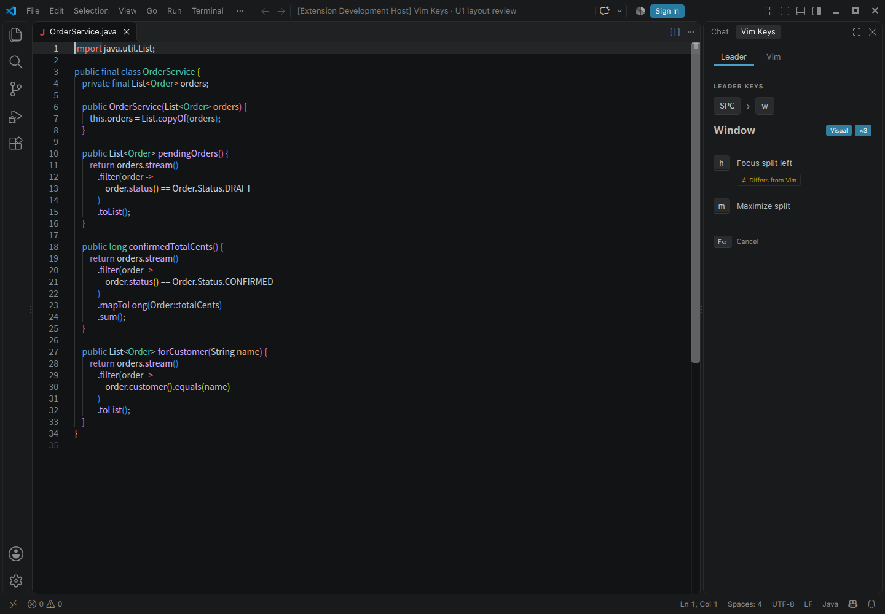

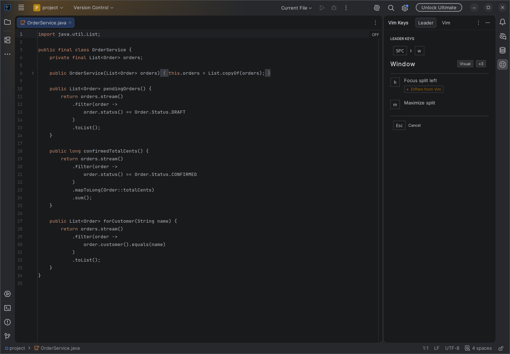

### Split editors, 1440 × 1000

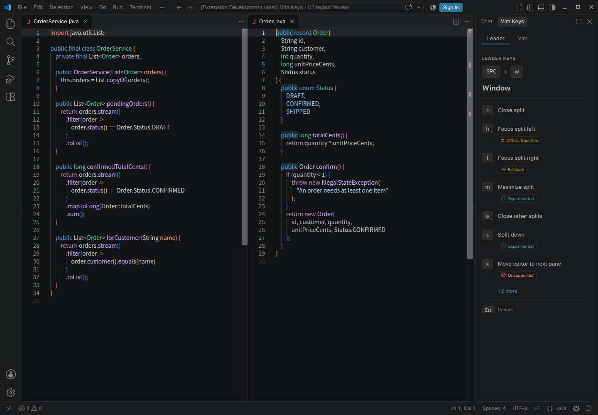

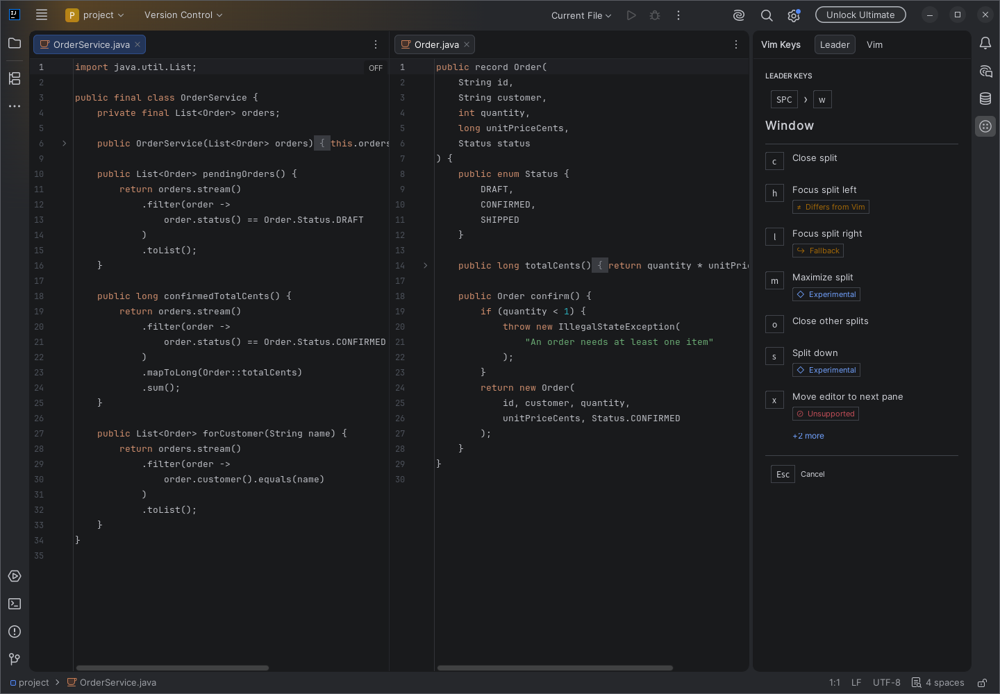

### Small split, 1100 × 800

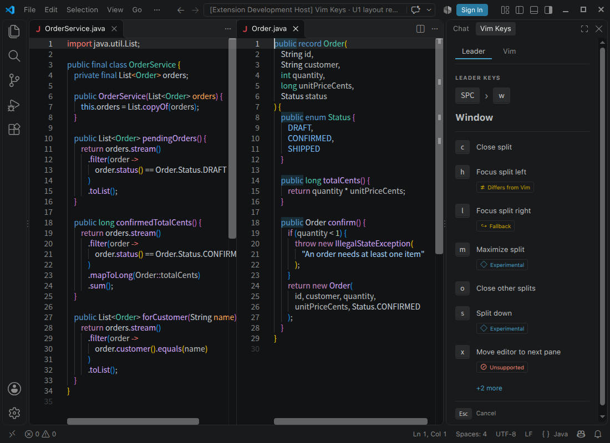

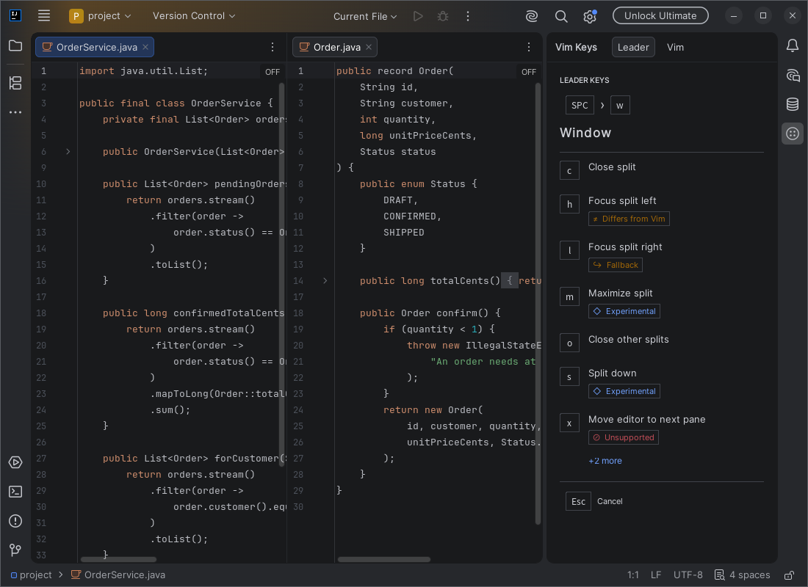

### Same small split, Vim Keys hidden

The user explicitly hides the view. The harness then changes its state to prefix; it remains hidden. The companion does not change the editor layout to make room for itself.

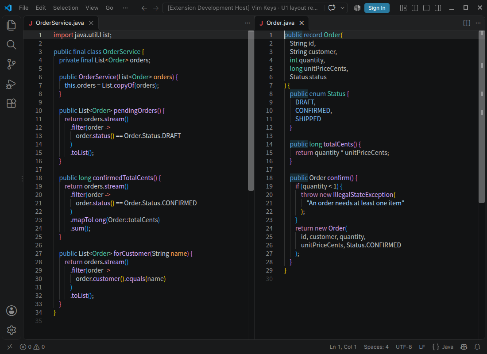

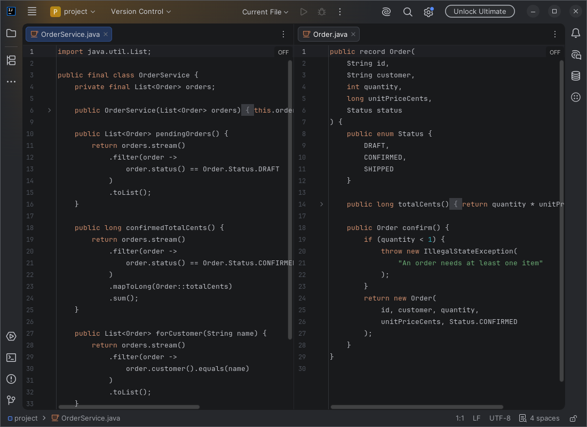

## What this establishes

Measured: in one final capture per shown IntelliJ layout, the right tool window was 320 px wide and its bounds did not intersect either editor viewport. In the 1100 px split window, the two code viewports were only 282 and 281 px wide; after hiding the view they were 442 and 441 px. Docking removes code overlap but does not make a small split spacious.

Measured: the VS Code webview content was 289 CSS px wide in each shown layout. The real secondary side bar was captured with one or two editor groups. The images expose the width trade-off; no editor pixel-bound measurement is claimed for VS Code.

Measured: one fixed-state update while hidden in each sandbox left the view hidden. This is a narrow prototype visibility check, not a focus, key-ownership or engine acceptance test. No keys were injected.

The design therefore keeps showing and hiding under user control. A small window with two editors may be better used with the learning view closed, or with one editor group. The prototype does not automatically resize, reposition or open the view while displaying hints. Initial placement, window sizing and editor splits in the capture harness are explicit review setup.

## Content decisions

- Keycaps, command names and group chevrons form the main hierarchy. The prefix stays above the group name; Visual and count use separate chips.
- Badges have both icons and text, below the command label. Both IDEs show the same seven rows and `+2 more`; the two aliases remain in the data. Expansion is only illustrated.
- The Doctor notice is a fixed one-conflict scenario, not a live diagnostic result.
- The Vim tab combines reference browsing with simulated contextual guidance. Its original operator-and-motion card remains a separate review cell. Native Vim input does not require Space. All guidance examples are explicitly marked as previews, independent of S2 qualification.
- IntelliJ uses a real right-anchored, docked, pinned `Vim Keys` tool window with native Leader/Vim tabs for every state. The POPUP_LAYER host measured by S3 is not used by this direction.

## Gallery

### Idle

| VS Code: Keys view                       | IntelliJ: Leader tab                        |
| ---------------------------------------- | ------------------------------------------- |
| 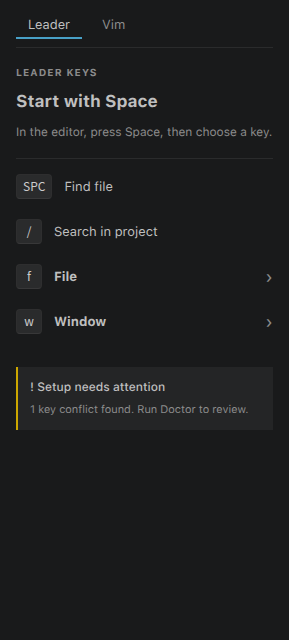 | 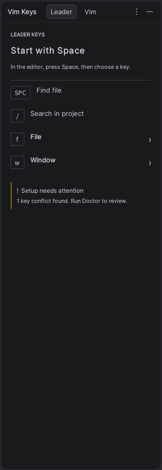 |

### Prefix

| VS Code: `SPC › w`                           | IntelliJ: Leader tab                            |
| -------------------------------------------- | ----------------------------------------------- |
| 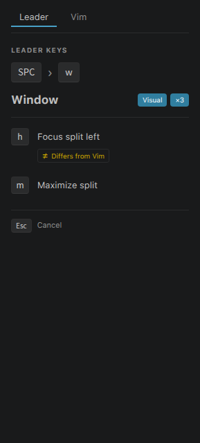 | 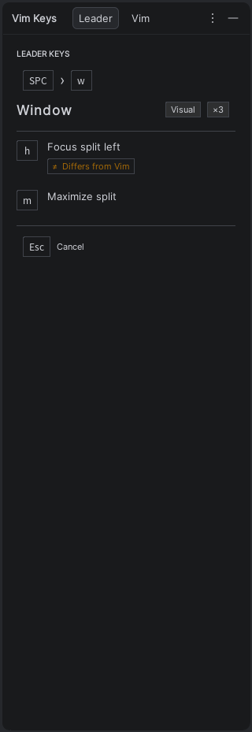 |

### Badges and long labels

| VS Code                                      | IntelliJ                                        |
| -------------------------------------------- | ----------------------------------------------- |
| 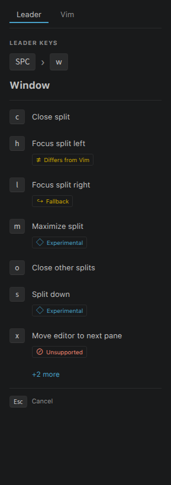 | 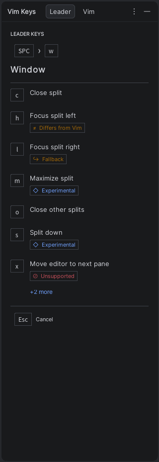 |

### Grammar

| VS Code: reference card                        | IntelliJ: Vim tab                                 |
| ---------------------------------------------- | ------------------------------------------------- |
| 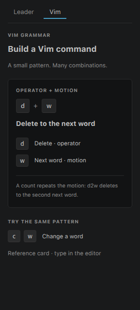 | 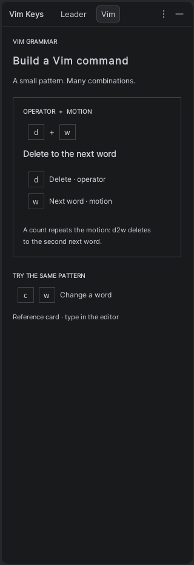 |

## Native Vim learning

All six pairs below are **simulated presentation states**. They do not show observed engine input or prove that either engine supports live guidance. Each screenshot selects a different topic for review; later context updates leave the user's browsing selection intact. The gallery uses baseline Vim semantics. User remaps and engine-specific differences require separate product work.

### Reference browsing

Start with Movement; browse all five topics without entering a leader sequence.

| VS Code: Vim                                                       | IntelliJ: Vim                                                         |
| ------------------------------------------------------------------ | --------------------------------------------------------------------- |
| 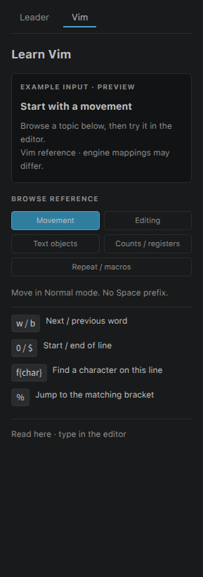 | 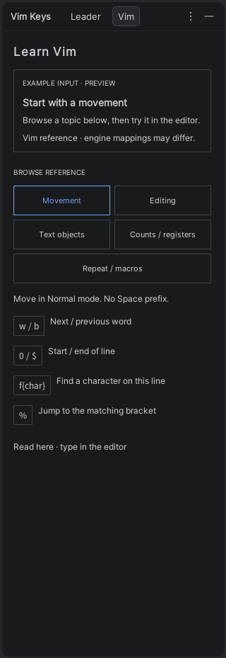 |

### Pending `d`

Choose a motion or text object to finish the delete operator.

| VS Code: Vim                                       | IntelliJ: Vim                                         |
| -------------------------------------------------- | ----------------------------------------------------- |
| 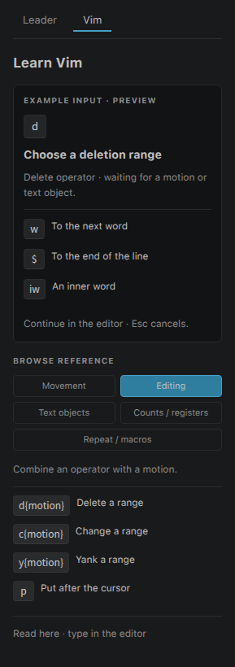 | 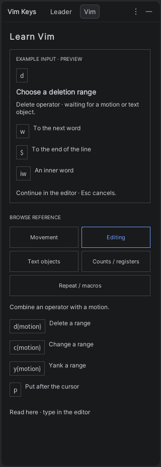 |

### Pending `di`

Choose the inner object; `w`, `"`, and `(` are continuations, not complete commands.

| VS Code: Vim                                         | IntelliJ: Vim                                           |
| ---------------------------------------------------- | ------------------------------------------------------- |
| 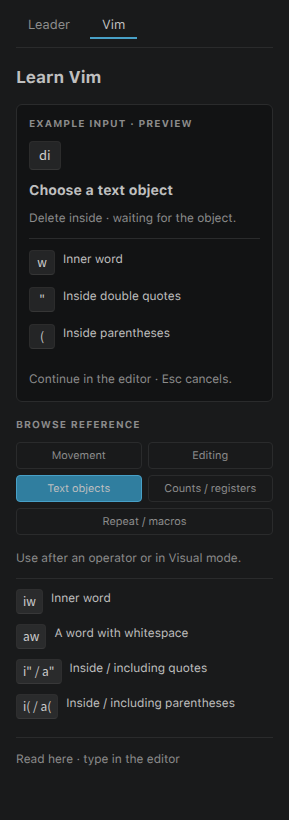 | 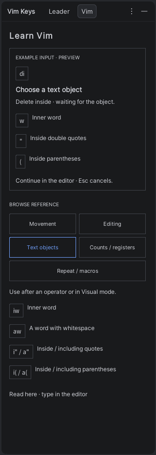 |

### Pending `f`

Wait for an arbitrary target character on the current line, rather than listing a command menu.

| VS Code: Vim                                       | IntelliJ: Vim                                         |
| -------------------------------------------------- | ----------------------------------------------------- |
| 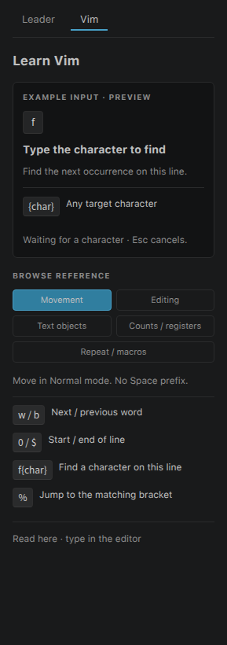 | 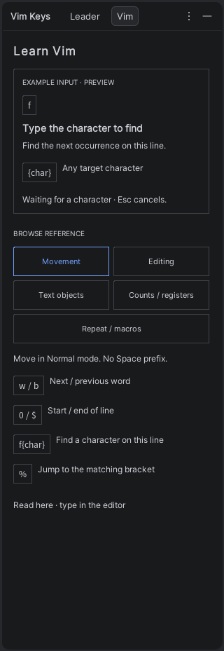 |

### Pending `"a3d`

Keep register `a`, count `3`, and the delete operator visible while waiting for the range.

| VS Code: Vim                                                     | IntelliJ: Vim                                                       |
| ---------------------------------------------------------------- | ------------------------------------------------------------------- |
| 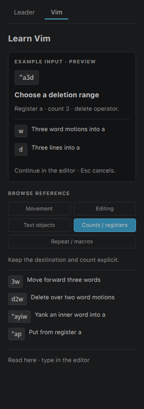 | 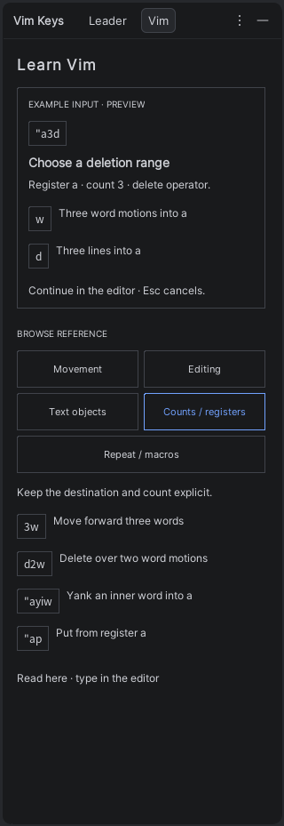 |

### Live guidance unavailable

Keep reference browsing usable; macro playback has reference help only.

| VS Code: Vim                                                           | IntelliJ: Vim                                                             |
| ---------------------------------------------------------------------- | ------------------------------------------------------------------------- |
| 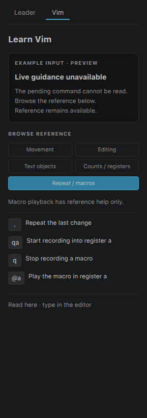 | 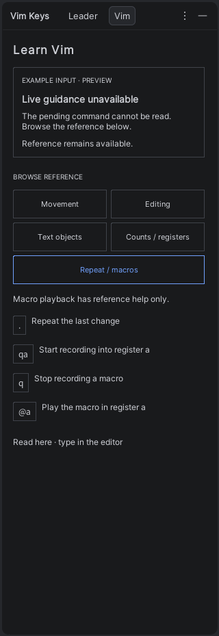 |

## Sources and capture

The preparation tool reads `root-vscode` and `window-vscode` from `spec/fixtures/hint-view/menu.json`, and `each-kind-vscode` from `spec/fixtures/hint-view/badges.json`. It adds the synthetic unsupported row `Move editor to next pane` (24 characters) before the aliases. `vim-learning.json` supplies the same fixed reference and context data to both renderers. Catalogs and original fixtures are unchanged. The Java files in `sample/` are display fixtures, not product code.

VS Code **1.141.0** supplies the real webview and secondary side bar. Its static component gallery uses the same HTML builder, stylesheet and renderer with the captured Dark 2026 tokens. The ten static renders used Google Chrome **156.0.8078.73**, at scale 1, with zero CSP violations and no viewport overflow. The capture driver also checked that selecting Text objects survives a `d` update and an unavailable update, and that both tabs remain selectable. The four context captures are X11 captures of the VS Code window, not the desktop. The state commands update content without revealing the view; only the explicit sandbox setup opens it.

IntelliJ IDEA **2026.2.3 / 262.10968.63** runs through `runIde` in a fresh temporary sandbox. The internal `UI Gallery` action captures the actual docked component and IDE root pane with Swing `printAll`. It uses `themes/islands/ManyIslandsDark.theme.json`, compact mode off, at scale 1. The actual editor scheme is recorded in the metadata. A sandbox JDK configuration prevents unrelated SDK warnings on the synthetic Java project. No personal profile or scheme is copied, and no IdeaVim plugin is loaded.

Measured: in one native IntelliJ capture run, all six added Vim states fit vertically in the component viewport, and two context updates preserved the selected Text objects topic. The capture completed without severe IDE errors. These checks cover the prototype only.

Metadata: [VS Code theme](gallery/vscode-theme.json), [VS Code components](gallery/vscode-capture.json), [VS Code layouts](gallery/vscode-context.json), [IntelliJ components](gallery/intellij-capture.json), [IntelliJ layouts](gallery/intellij-context.json).

Vim reference sources: [motions and text objects](https://vimhelp.org/motion.txt.html), [operators and registers](https://vimhelp.org/change.txt.html), [repeat and macros](https://vimhelp.org/repeat.txt.html). These describe Vim semantics, not observed VSCodeVim or IdeaVim behavior.

API references: [VS Code webviews](https://code.visualstudio.com/api/extension-guides/webview), [IntelliJ tool window modes](https://www.jetbrains.com/help/idea/viewing-modes.html).

## Reproduce

Use Node 24, pnpm 11, Java 25, VS Code 1.141.0, Google Chrome, Xvfb, xdotool, ImageMagick (`import`), Python 3 with Pillow, and IntelliJ IDEA 2026.2.3. The existing Gradle 9.8.1, IntelliJ Platform plugin 2.19.0 and Kotlin 2.4.21 are unchanged. The IntelliJ build uses the installed IDE and its bundled Java plugin; it never runs Node.

From the repository root:

```bash
# Prepare shared fixture data and the component gallery.
node spec/tools/u1-gallery.mjs
bash spikes/u1/capture-vscode-theme.sh
node spec/tools/u1-gallery.mjs --html
node spec/tools/u1-capture-web.mjs

# Capture real IDE layouts. JAVA_HOME must point to Java 25.
env -u WAYLAND_DISPLAY xvfb-run -a -s '-screen 0 1440x1000x24' \
  node spec/tools/u1-capture-context.mjs
U1_IDEA_HOME="$HOME/.local/share/JetBrains/Toolbox/apps/intellij-idea-ultimate" \
  bash spikes/u1/capture-intellij.sh

node spec/tools/u1-check-images.mjs
# After pushing, check the exact image permalinks.
node spec/tools/u1-check-images.mjs --commit "$(git rev-parse HEAD)"
```

## Remaining work

Review the native Vim learning content before expanding to the complete **24 VS Code + 28 IntelliJ** theme/state gallery. IntelliJ prefix and badges now belong in the Leader tab instead of an overlay. The twelve native Vim scenario images and eight full-window layout images are additional review material; they do not replace required theme cells.

Bright and high-contrast themes, compact mode, One Dark 6.2.2, the 170 px and bottom-panel layouts, live input/focus, accessibility, performance and native Wayland/macOS remain unverified. No final U1 approval or verdict is claimed. Each IDE still needs its own final gallery approval in #9 before Phase 3 UI implementation.
